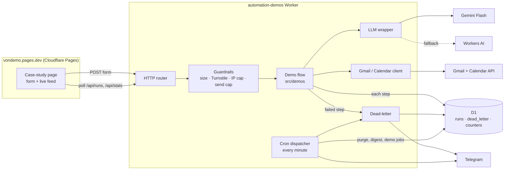

# Architecture

## Requests

1. A form posts JSON to a demo route. `guardForm` checks the size (8 KB for forms), the schema and field lengths,
   the Turnstile token, then takes one of the visitor's 3 runs for the day (keyed by a salted hash of bucket, day
   and IP).
2. The demo starts a `Run`. Each `run.step(name, fn)` times one step and writes it to D1 as it finishes, so the
   visitor's timeline fills in live (the page polls every few seconds).
3. AI steps call `generateJson` with a zod schema. The schema goes to Gemini as `responseJsonSchema`; the answer is
   validated; a bad answer gets one retry with the validation error; then Workers AI answers the same prompt. The
   step records which model answered and how many attempts it took.
4. Before sending an email the demo calls `takeSendQuota`. Past the daily cap (60), it shows the email on the page.
5. A step that fails after the AI fallback, or a Google call that fails, goes through `stepWithDeadLetter`: the
   payload is stored in `dead_letter`, Von gets a Telegram alert, and the run is marked failed with the step name.

## Schedules

The account has 5 cron triggers in total, so the Worker uses one (`* * * * *`). `dispatch` records the tick and
runs every job whose `due(at)` is true. Core jobs:

| Job | When | What |
|---|---|---|
| `dead-letter-retry` | every 5 min | retries due items: backoff 5 min, 30 min, 2 h, then abandoned |
| `privacy-purge` | 18:00 UTC (02:00 Manila) | clears visitor data and old errors after 7 days, cancels demo calendar events, runs demo purge hooks |
| `daily-digest` | 13:00 UTC (21:00 Manila) | Telegram summary: runs, success rate, emails sent, pending dead-letter |

Demos add their own with `registerCron` (follow-ups, reminders, the invoice inbox) and `registerPurge` for their
tables. A job that throws is logged as a failed `core` run and alerts Telegram, every time.

## Data

`migrations/0001_core.sql`. Public columns of `runs` feed the site. `runs.pii`, `runs.error` and
`dead_letter.payload` are private: the API never returns them and the purge clears them after 7 days.
Run rows themselves are kept 90 days for the stats. D1 never pauses, so there is no keep-alive job.

## Limits that shaped the design

- Workers free plan: 10 ms CPU per request (waiting on fetch does not count), 50 subrequests per request,
  100,000 requests a day. PDFs and images go to Gemini as inline data; the Worker never parses them.
- The every-minute cron is 1,440 invocations a day, each a few D1 queries: well inside the free limits.
- Gmail's consumer send limit is far above the demo's own cap of 60 a day.
